---
format:
  revealjs:
    theme: [default, ../../shared/revealjs/default.scss]
    width: 1440
    height: 810
    margin: 0
    center: false
    auto-stretch: false
    slide-number: c
    show-slide-number: all
    progress: false
    controls: false
    transition: none
    background-transition: none
    preview-links: auto
    chalkboard: true
  pptx:
    reference-doc: ../../shared/pptx/owada-reference.pptx
    filters:
      - ../../shared/pptx/pptx-style.lua
execute:
  echo: true
  warning: false
---

## 部分観測環境における 意思決定のための履歴表現学習 {.owada-title data-subtitle="大和田 晃生" data-date="2026-11-11"}

# 背景 {.owada-section}

## 強化学習を扱うモチベーション {.owada}

強化学習は、人間が最適な行動をあらかじめ教えなくても、試行錯誤を通じて優れた意思決定を獲得できる

→ 獲得された行動や戦略を分析することで、人間が想定できなかった解決方法や、問題そのものに関する新たな知見が得られる可能性がある

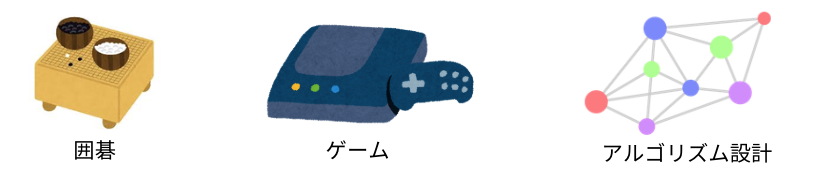

本研究では、環境の一部しか観測できない状況において、過去の経験から意思決定に必要な情報を抽出し、効率的に学習するための表現方法に注目したい

# 前提知識 {.owada-section}

## 強化学習の基本 {.owada}

エージェントが環境のある状態 $s$ で行動 $a$ を選択し、環境から次の状態 $s^\prime$ と報酬 $r$ を受け取る相互作用を繰り返すことで、得られる報酬が最大化する意思決定を学習する  

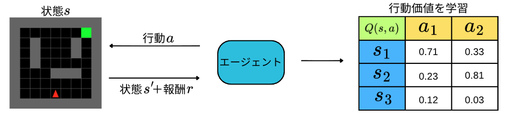

ある方策 $π$ に従った場合に得られる将来の累積割引報酬の期待値である、行動価値関数は以下の様に定義される

$$Q^\pi(s,a)=\mathbb{E}_{\pi}\left[\sum_{k=0}^{\infty}\gamma^k r_{t+k+1}\mid s_t=s,\ a_t=a\right]$$

::: {.notes}

:::

## 部分観測環境における強化学習 {.owada}

部分観測環境ではエージェントが各状態に対して限られた情報である観測 $o$ しか得ることができないため、状態を区別できず、適切な価値の判別・意思決定が難しい

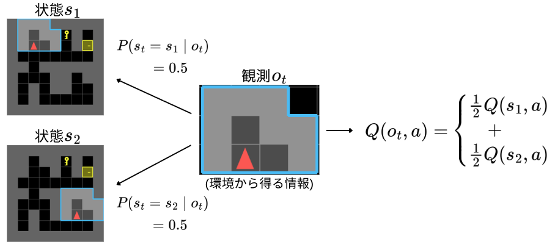

::: {.notes}
観測としては同じだけど、全然違うところにいるし、全然違う状態。
もちろん、この時に取るべき行動もこれらの状態では異なる。
だから、期待値である行動価値関数を学習することが難しい。
:::

## 履歴を用いて学習する {.owada}

そのため、過去の行動や観測の系列である履歴情報を用いることで、現在の状態を推測することができて適切な意思決定を学習することができる

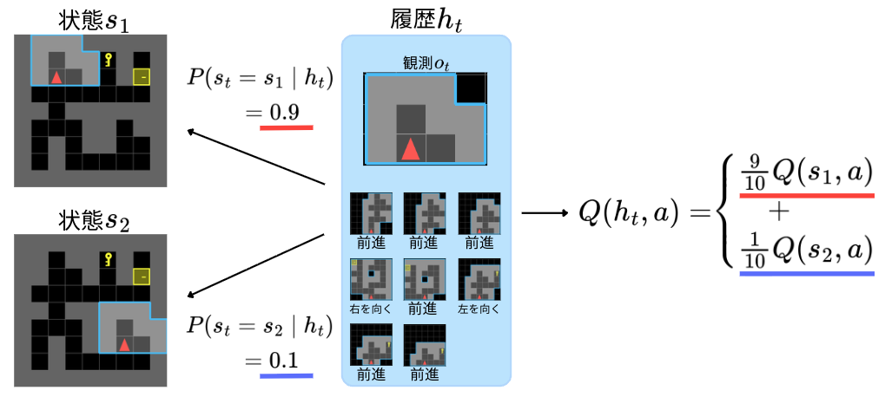

## 履歴の扱い方の注意 {.owada}

しかし、履歴をそのまま利用する場合、考慮すべき観測・行動列の組合せが膨大になる

観測空間を $\mathcal O$ 、行動空間を $\mathcal A$ とすると、時刻 $t$ における履歴空間 $\mathcal H_t$ の要素数の上限は

$$
|\mathcal H_t|\leq |\mathcal O|^t|\mathcal A|^{t-1}
$$

さらに、履歴の長さは時刻によって異なるため、最大時刻を $T$ としたとき、履歴全体の空間 $\mathcal H$ の要素数の上限は

$$
|\mathcal H|\leq\sum_{t=1}^{T}|\mathcal O|^t|\mathcal A|^{t-1}
$$

## 履歴の扱い方の注意 {.owada}

履歴を個別に区別して学習する場合、意思決定に影響しない違いを持つ履歴に対しても、それぞれ価値を推定する必要がある。つまり、表形式で保持すべき行動価値の数は、履歴空間 $\mathcal H$ と行動空間 $\mathcal A$ の要素数を掛け合わせた数となる

$$
N_{\mathrm{history}}=|\mathcal H|\cdot|\mathcal A|
$$

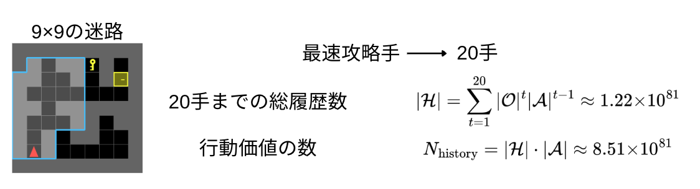

# 研究目標・研究課題 {.owada-section}

## 研究目標 {.owada}

履歴から意思決定に必要な情報を保持しつつ、不要な違いを取り除き、意思決定において類似する履歴を共通の潜在状態として集約することを目指す

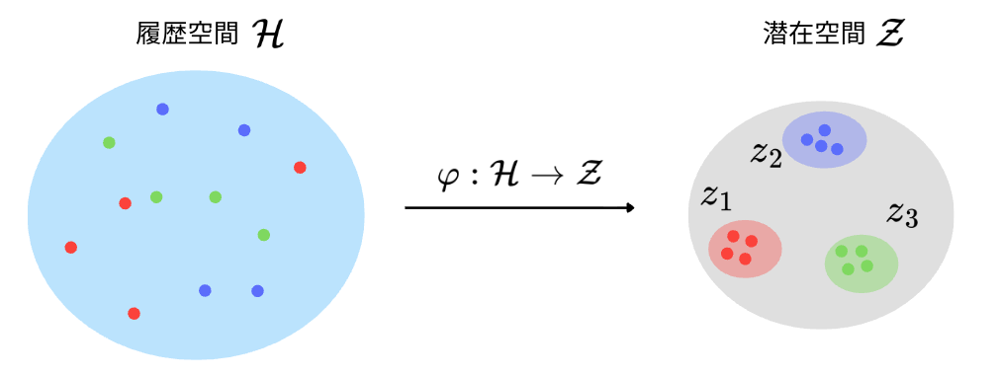

## 研究目標 {.owada}

さらに、集約された表現について、元々の環境をその間の遷移として扱える表現を獲得することで学習効率化を目指す

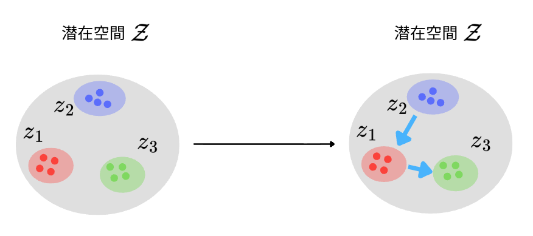

## 研究の大枠 {.owada}

時刻 $t$ までに得られた観測列 $o_1, o_2, \ldots ,o_t$ と行動列 $a_1, a_2, \ldots ,a_{t-1}$ からなる履歴 

$$
h_t = (o_1, a_1, o_2, a_2, \ldots, a_{t-1}, o_t)
$$

を履歴符号化器によって有限このクラスタに属した単一の潜在表現に圧縮する

$$z_t=f_\theta(h_t),\qquad z_t\in C_i,\quad i\in\{1,\ldots,K\}
$$
 
潜在表現は方策および価値関数に入力され、強化学習由来の損失 $\mathcal{L}_{\mathrm{RL}}$に基づいて最適化される。今研究ではさらに、補助損失 $\mathcal{L}_{\text{aux}}$ を加えることで潜在表現に必要な情報を保持させると同時に、表現の集約を促す

## 研究の大枠 {.owada}

環境の状態をクラスタ間の遷移として表現できる様な予測方法・遷移表現を考える

$$
P_{ij}^{a}=P(z'\in C_j\mid z\in C_i,a)
$$

 
今研究のおける検討対象は、補助損失、クラスタ表現方法、クラスタ間の遷移予測方法の設計である

## 研究課題 {.owada}

1. 潜在表現が異なる経験の共通性を捉えながら、必要な違いを保持し、方策や価値関数が実際に利用できること

$$\widehat Q_\phi(f_\theta(h),a)\approx Q_{\mathrm{ref}}(h,a),
\qquad
\pi_\omega(\cdot\mid f_\theta(h))\approx\pi_{\mathrm{ref}}(\cdot\mid h)
$$
 
2. 意味が類似する履歴を近い潜在表現として集約すること

$$
h\sim_{\mathcal S}h'
\quad\Longrightarrow\quad
d(f(h),f(h'))\le\varepsilon
$$
 
3. 同じクラスタから同じ制御規則で動くとき、次に移るクラスタの確率分布も似ていること

$$
P(c_{\mathrm{next}}=j\mid f(h),v)
\approx
P(c_{\mathrm{next}}=j\mid f(h'),v)
$$

# 本題 {.owada-section}

## 履歴から状態を表現する {.owada}

::: {.title-refs}
[1] Littman et al., 2001, NeurIPS "Predictive Representations of State"

[2] Esslinger et al., 2022, NeurIPS Workshop on Foundation Models for Decision Making, "Deep Transformer Q-Networks for Partially Observable Reinforcement Learning"
:::

履歴から特定の将来の予測ができる潜在表現をその時の状態として扱う

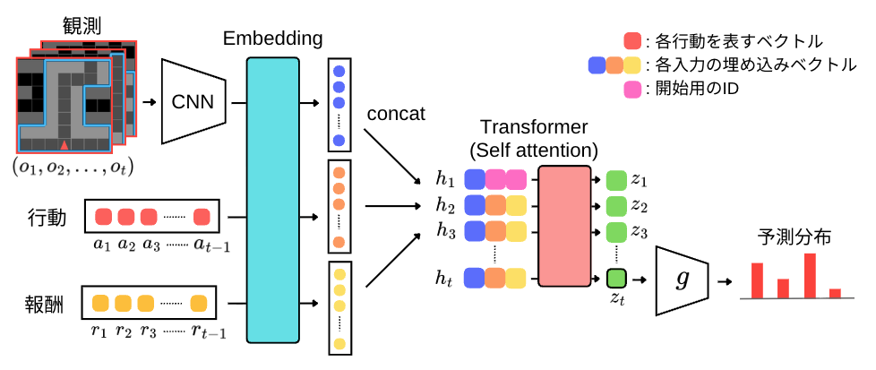

::: {.notes}
潜在表現は履歴をTransformerへ入力して作る。各時刻を一つのトークンにし、最後の時刻の出力を、そこまでの履歴の要約として使う。その表現から行動を選ぶとともに、E3では行動した後の将来収益も予測します。この背景には、将来の予測によって状態を表すPSRの考えがあります。今回も予測の学習を通して、履歴の中の有用な情報が表現に残ることを期待して使う。
:::

## 予備実験 {.owada}

過去に見た手掛かりを保持する記憶課題で、履歴表現の有効性を確認する

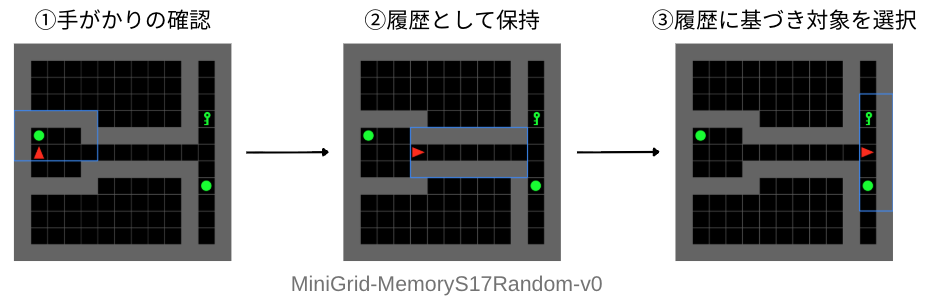

比較：2層Transformer、潜在表現の次元を32、128で比較

条件：最大128stepの履歴を入力、合計200万stepまで学習

学習：近位方策最適化（PPO）に、次潜在予測（E2）または将来収益予測（E3）を加える

## 予備実験結果 {.owada}

今回の条件では、幅32の方が高い成功率へ到達し、最終的な成功率も高かった

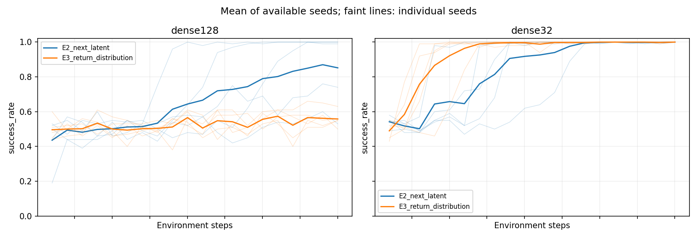

横軸は学習に使った環境step、縦軸は成功率

→ 32次元の潜在表現では、履歴の情報がどのように整理されているのか？

## 検証：履歴のどの違いを残すか {.owada}

同じ現在観測を持つ履歴について、過去の情報だけを変え、潜在表現の変化を調べる

|変えるもの|判断への影響|表現に求めること|
|---|---|---|
|過去に見た手掛かり|正しい行動が変わる|違いを残す|
|履歴長さの変更|正しい行動は変わらない|違いの影響を小さくする|

 
単に履歴を似た表現にするだけでなく、必要な違いを保った集約になっているかを確認する

 
学習済みEncoderを固定し、現在観測・位置・向き・経過時間を揃えた履歴を入力

## 検証結果 {.owada}

32次元では、手掛かりを変えた差が大きく、履歴長の変更による差が小さかった

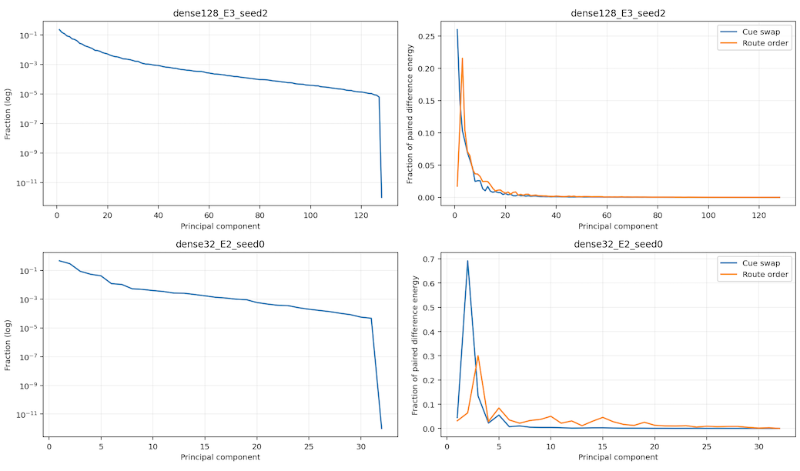{width=850}

## 情報を判断に使えているか {.owada}

## スライドタイトル {.owada}

## スライドタイトル {.owada}

## スライドタイトル {.owada}

## スライドタイトル {.owada}

## スライドタイトル {.owada}

## スライドタイトル {.owada}

## スライドタイトル {.owada}

## スライドタイトル {.owada}

## スライドタイトル {.owada}

## スライドタイトル {.owada}

## まとめ {.owada}

この発表で伝えたい結論を書く。

## 参考文献 {.owada}

[1]

[2]

[3]

# Appendix {.owada-section}

## モデル詳細 {.owada}

## 
